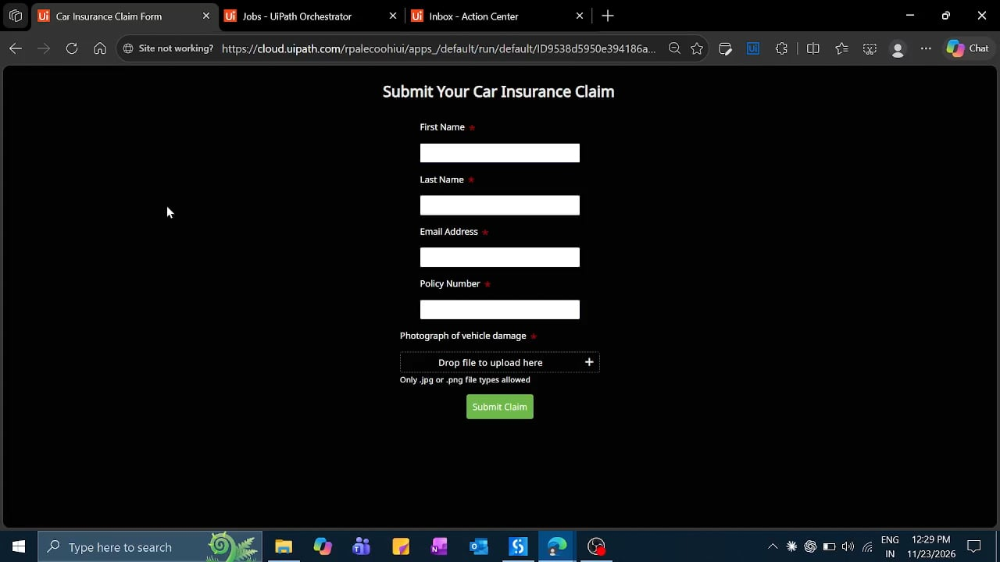
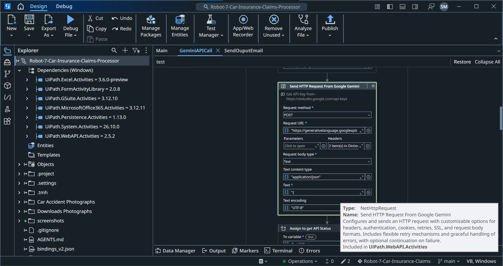
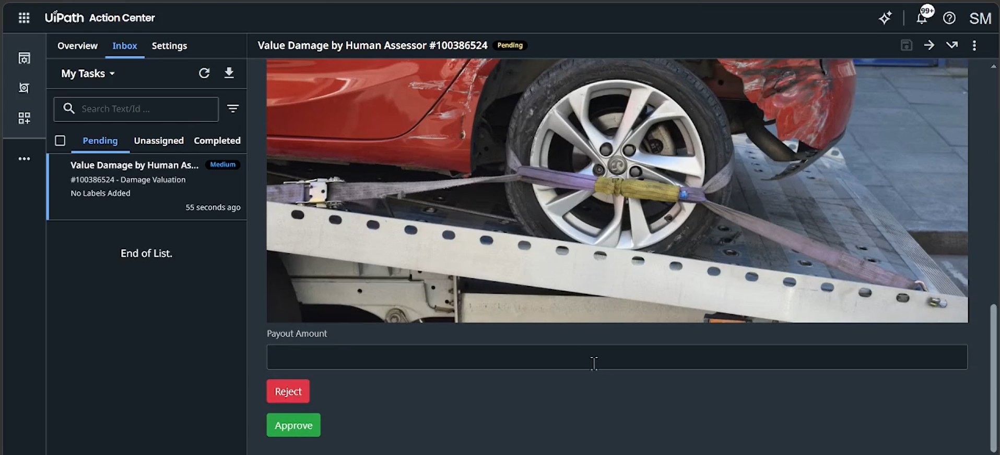

# Robot 7: Car Insurance Claims Processor


An end-to-end car insurance claims processor that combines **rules-based RPA**, **AI decision making** and a **human-in-the-loop** approval step, built on the UiPath platform.

---

##  Overview

The process starts when a member completes an online claims form with their **policy number** and a **photo of the car damage**. The form is built with **UiPath Apps** and is an external (public) app.

Submitting the form triggers an RPA workflow that:

1. Checks that the policy number exists and and membership status is active in an internal database.
2. Calls a **Google Gemini LLM** through the HTTP Request activity to check whether the damage image is **AI-generated**.
3. If the image is genuine, loads it into **UiPath Action Center** as a form task for a human assessor.
4. Waits for the assessor to enter the **damage value** and **approve or reject** the claim.
5. Resumes after the assessor submits, and **makes the payment automatically**.

---

##  Demo Video

> This is a demonstration of the car insurance claims processor, triggered when a member completes the form built with UiPath Apps. It then creates a task in UiPath Action Center for a human to approve or reject the claim.

[▶️ Watch the demo](https://vimeo.com/1249237471?fl=ip&fe=ec&share=copy)

---

## Screenshots

### 1. Claims Form (UiPath Apps)

*Public claims form with policy number and damage photo upload.*

### 2. Workflow in UiPath Studio

*RPA workflow.*

### 3. Action Center Task

*Assessor form showing claim details and damage image.*

---

## Gemini Request Body (AI Image Check)

The workflow sends the damage photo to Gemini using the **HTTP Request** activity. The image is converted to base64 and embedded in the request body. Gemini is asked to return structured JSON, which the workflow parses to decide whether the claim continues to the human assessor.

```json
{
  "contents": [{
    "parts": [
      {
        "text": "You are reviewing a photograph submitted as evidence for a vehicle accident insurance claim, on behalf of the insurer. Your job is to detect whether the image is AI generated or AI edited, so the insurer can identify members who are trying to claim for fake or fabricated damage. Check for fully AI generated images and for real photographs that have been altered with AI tools, such as added, enlarged, or removed damage, generative fill, inpainting, altered license plates, or changed backgrounds. Look for artifacts such as inconsistent lighting or shadows, warped or illegible text and license plates, unnatural textures, impossible reflections, damage patterns that do not match the vehicle's panels or the described impact, and distorted vehicle parts. If any AI generation or AI editing is detected, set isAIGenerated to true. Set it to false only if the image appears to be an authentic, unaltered photograph. Standard non-AI adjustments such as cropping, resizing, or brightness changes alone do not count as AI editing. Return Confidence as a number from 0 to 100 showing how confident you are in your isAIGenerated answer, and Reason as a short explanation citing the specific visual evidence behind your conclusion."
      },
      {
        "inlineData": {
          "mimeType": "image/jpeg",
          "data": "<BASE64_IMAGE_STRING>"
        }
      }
    ]
  }],
  "generationConfig": {
    "responseMimeType": "application/json",
    "responseJsonSchema": {
      "type": "object",
      "properties": {
        "isAIGenerated": {
          "type": "boolean",
          "description": "True if the image is AI generated or contains any AI editing, false only if it appears to be an authentic, unaltered photograph."
        },
        "Confidence": {
          "type": "number",
          "minimum": 0,
          "maximum": 100,
          "description": "How confident the model is in its isAIGenerated answer, from 0 to 100."
        },
        "Reason": {
          "type": "string",
          "description": "Explanation of the specific visual evidence that led to the isAIGenerated conclusion."
        }
      },
      "required": ["isAIGenerated", "Confidence", "Reason"]
    }
  }
}
```

**Notes**

- `<BASE64_IMAGE_STRING>` is a placeholder. In the UiPath workflow it is replaced with the `Base64String` variable, built by concatenating it into the body string.
- Inside a VB.NET string in UiPath, every double quote in the JSON must be doubled (`""`).
- The response schema forces Gemini to return three fields: `isAIGenerated` (boolean), `Confidence` (0 to 100) and `Reason` (text).
- The Gemini API key is stored as an Orchestrator secret asset and is never included in this repository.

---

##  Process Flow

```
Policy Member submits claim (UiPath Apps)
            │
            ▼
Orchestrator triggers unattended RPA workflow
            │
            ▼
Validate policy number (internal database / Excel File)
            │
     ┌──────┴──────┐
  Invalid        Valid
     │              │
  Reject            ▼
               Validate Membership Status
                    |
             ┌──────┴──────┐
         Invalid          Valid
            |               |
         Reject      Gemini API: is the image AI-generated?
                              │  
                       ┌──────┴──────┐
                    AI-generated   Genuine
                       │             │
                     Reject          ▼
                           Action Center form task
                        (assessor enters damage value,
                           approves or rejects)
                                     │
                                     ▼
                     Bot resumes with assessor's decision
                                     │
                                     ▼
                           Automatic payment processed
```

## Tech Stack

| Component | Purpose |
|-----------|---------|
| **UiPath Apps** | Public-facing claims form with validated inputs and image upload |
| **UiPath Studio** | Building the RPA workflow |
| **UiPath Orchestrator** | Triggering the process, secret assets, folder and tenant permissions |
| **Automation Cloud Storage Buckets** | Storing and retrieving uploaded damage photos |
| **UiPath Action Center** | Human-in-the-loop approval form |
| **Google Gemini API** | AI check on whether the damage image is AI-generated |
| **HTTP Request activity** | API calls to Gemini |

---


## ⚙️ Prerequisites

- UiPath Automation Cloud account with access to **Studio**, **Orchestrator**, **Apps** and **Action Center**
- A Google Gemini API key
- An internal database (or Excel File) holding policy records
- An Automation Cloud storage bucket

---

## 🚀 Getting Started

1. **Clone the repository**
   ```bash
   git clone https://github.com/Shaik-Mustaq/Robot-7-Car-Insurance-Claims-Processor.git
   ```
2. **Open the project** in UiPath Studio.
3. **Store your Gemini API key** as a secret asset in Orchestrator. Never hard-code it in the workflow.
4. **Create the storage bucket** in Automation Cloud and link it to the app and the process.
5. **Publish the process** to Orchestrator and configure folder and tenant permissions for external app access.
6. **Publish the UiPath App** and share the public link.
7. **Submit a test claim** and follow it through Action Center.

---

## Security Notes

- API keys are kept in **Orchestrator secret assets**.
- External app access is limited through tenant and folder permissions.
- Don't commit credentials or real policy data to this repository.

---

##  Repository Structure

<!-- Update this to match your project layout -->
```
Robot-7-Car-Insurance-Claims-Processor/
├── README.md
├── screenshots/        
├── Main.xaml  --> Vaidates the Policy / Membership Status
├── GeminiAPICall.xaml  --> Make the Actual HTTP Request
├── SendOutputEmail --> For human review
├── InsurancePolicies.xlsx --> Policy Records
├── Car Accident Photographs/ -->Test Images
├── Downloads Photographs/--> Downloads Images from the  storage bucket

```

---

##  Author

**Shaik Mustaq**
GitHub: [@Shaik-Mustaq](https://github.com/Shaik-Mustaq)

---

##  Repository
[Robot-7-Car-Insurance-Claims-Processor](https://github.com/Shaik-Mustaq/Robot-7-Car-Insurance-Claims-Processor)
